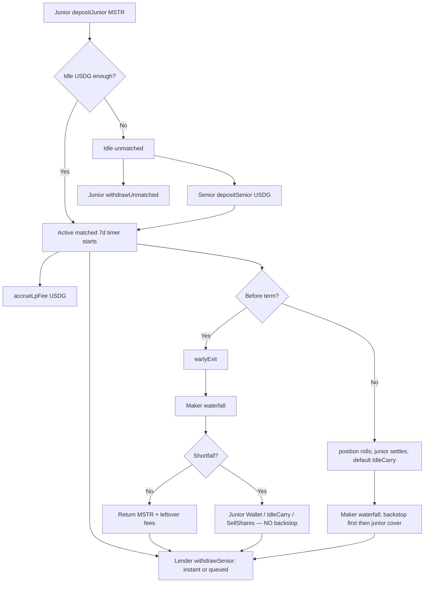

# Carry / Levered LP Vault — Contract Pack

Grant- and audit-oriented reference for `contracts/src/LeveredLpVault.sol` (UUPS implementation).  
Deploy steps live in [`CARRY_TESTNET.md`](./CARRY_TESTNET.md).  
Docs index: [`docs/README.md`](./docs/README.md).  
Maker-locked product rules + research sync: [`docs/MAKER_V1_NOTES.md`](./docs/MAKER_V1_NOTES.md).  
**Fee waterfall (product source of truth):** [`docs/MAKER_FEE_WATERFALL.md`](./docs/MAKER_FEE_WATERFALL.md) — Morpho-rate senior floor, treasury/seniorPerf/junior split **only** at claimFees / earlyExit / settle.  
**Accounting (v3 source of truth):** [`docs/ACCOUNTING_V3.md`](./docs/ACCOUNTING_V3.md).  
v2.5 notes kept in [`docs/ACCOUNTING_V25.md`](./docs/ACCOUNTING_V25.md) (superseded).

**Live product CA (PROXY):** [`0x24B799026AA7baa6856bCFD00c1Be1f583A83e35`](https://explorer.testnet.chain.robinhood.com/address/0x24B799026AA7baa6856bCFD00c1Be1f583A83e35) (`version() = v3-lender-pool`, impl `0x7BeE…778E`; also `public/config.json` → `chain.vault`).  
**Superseded v2.5 PROXY:** [`0xc80108649B3ba2e5B040c79DDE3af0cB979b72bd`](https://explorer.testnet.chain.robinhood.com/address/0xc80108649B3ba2e5B040c79DDE3af0cB979b72bd) — history only; its settle-watch positions are settled.  
**Site:** [usecarry.io](https://usecarry.io).

This pack describes the vault source on `main`. The live testnet impl predates three merged changes (EIP-170 fit #3, rolling positions #16, `StrategyBoostHook` #23) and picks them up at the next owner-signed upgrade.

v3 product: Maker waterfall, **lender pool shares**, FIFO withdraw queue, **floating rate index**, uncapped senior pool, junior $25k cap, $25 min, cover orders per Maker v3, gas refund only on match (scaled), auto-compound with under-$25 wallet payout, explicit withdraw unmatched always wallet.

**v1 grant reference (not in use):** `0x72A0…36c8` (immutable; old 4%/5%/fee-in cut story applies only there).

**Status:** EVM testnet. DualPool hook is **NOT IMPLEMENTED** (`dualPoolAdapter() == address(0)`). LP fees on testnet are pushed via `accrueLpFee` / `MockFeePool` (fee-donor path for demos). No Yieldz or Morpho ERC-4626 sleeve. Morpho rate / Idle USDG display rates are config stubs. Boosted reads a separate `boostHook` (none set on testnet yet; no STRATEGY yield minted).

**Lender rate is changing.** The owner-set Morpho rate below is a testnet stub, not a promised APY. The mainnet lender return is being reworked to Morpho yield (floating) + Carry's share of fees with no fixed rate or floor (issue #20, PR #21). Sections that describe `seniorFloor`, `morphoRateWad` and cover for an accrual shortfall will change with that rework.

---

## 1. Overview

### Plain language

Carry lets a stock-token holder (junior) and a USDG lender (senior) form a **50/50 book**: junior posts MSTR, senior posts matching USDG. The intended production product runs that inventory in a Uniswap v4 DualPool-style hook at ~2× notional so the depositor’s equity tracks the stock while the pair earns swap fees.

This vault is the **custody + accounting layer** for that product on testnet:

- Junior deposits MSTR → **Idle** (unmatched) until USDG is available, then **Active**. Product states: **Idle / Active / Boosted / Closed**.
- Active window is **7 days** (product copy: “active”, not “locked”; positions roll over, never auto-close).
- **Live UUPS product:** senior accrual = floating rate index driven by an owner-set testnet stub (`morphoRateWad`, cap **≤5%**) × principal; fee waterfall at claim/exit/settle only (see [`docs/MAKER_FEE_WATERFALL.md`](./docs/MAKER_FEE_WATERFALL.md)).
- **Early exit cover:** junior chooses Wallet / IdleCarry / SellShares (**NO backstop**). **Settle:** backstop first, then junior Wallet / IdleCarry / SellShares; **default settle mode = IdleCarry**. SellShares sells MSTR through the sell router; with no router it reverts.
- Lenders hold shares in **one USDG pool**. `withdrawSenior` is instant when idle USDG covers it and the queue is empty; otherwise it joins a FIFO queue and the lender calls `claimWithdraw()` once filled.

### For auditors

| Item | Value |
| --- | --- |
| Contract | `LeveredLpVault` / `LeveredLpVaultV2` behind UUPS PROXY |
| Tokens | Immutable `mstr`, `usdg` ERC-20s |
| Oracle | Immutable `IPriceOracle` (`mstrPriceWad()`) |
| Term | Immutable `term` ≤ 7 days |
| Morpho rate | Owner-set `morphoRateWad` ≤ `MAX_MORPHO_RATE_WAD` (5%) driving a global floating `rateIndex`; positions snapshot the index at match (testnet stub; see rate note above) |
| Fee split | Maker waterfall at claim/exit/settle; treasury base 20% (Boosted cut from `boostHook`, capped at base) + seniorPerf 20% |
| Accounting | One lender pool (`totalSeniorAssets`) with non-transferable internal shares; senior yield compounds into the share price |
| Caps | `minDepositUsdg` $25; `maxTotalSeniorUsdg` 0 (uncapped); `maxTotalJuniorUsdg` $25k; **no per-wallet cap** on any market |
| Unpaid accrual | Carried on `Position.unpaidSeniorAccrual` when fees &lt; accrual |
| Pause | Owner pause/unpause deposits only (auto-compound reopen bypasses pause + caps) |
| Pool | No approvals to PoolManager; `joinPool` always reverts |
| Reentrancy | `nonReentrant` on all value-moving externals |

Inventory stays in the vault until a reviewed DualPool adapter exists. Mark-to-market `mark()` reports 2× equity as “hold the MSTR” vs an unlevered 50/50 √p comparison; it does **not** move inventory.

---

## 2. Actors

| Actor | Role | Key actions |
| --- | --- | --- |
| **Junior** (stock depositor) | Posts MSTR | `depositJunior`, `withdrawUnmatched`, `earlyExit`, `fundGasCredit`, `setAutoCompound`; receives leftover MSTR/fees on settle |
| **Senior** (lender) | Posts USDG into the pool | `depositSenior`, `withdrawSenior` (instant or queued), `claimWithdraw` |
| **Owner / protocol** | Pause + upgrade + knobs | `pause`, `unpause`, `upgradeToAndCall`, caps/boost hook/rate, `rescueToken` (non-principal only). **Cannot** pull MSTR/USDG principal |
| **Mock pool / fee donor** | Simulates LP fees | `accrueLpFee` / `MockFeePool.payFee` pushes USDG in |
| **Anyone** | Keepers, lenders, Carry | `settle` a position that has stopped rolling: past term, priced more than 32% below entry, and 48h past the last term boundary (proceeds still go to junior + seniors, not caller) |

**NOT IMPLEMENTED as separate actors:** Morpho idle allocator, live STRATEGY token (boost reads a separate `boostHook`; none set on testnet yet), geoblock, DualPool hook, Yieldz.

---

## 3. Lifecycle



Numbered happy path:

1. **Deposit stock** — `depositJunior(mstrAmount)` (≥ $25 notional). Partial match OK; residual stays in Idle queue.
2. **Lend USDG** — `depositSenior(amount)` (≥ $25). Mints pool shares; the withdraw queue is filled first, then Idle juniors are matched FIFO. First match snapshots the rate index, locks `treasuryCutLocked` (from `boostHook` when set) and starts the term clock.
3. **Active** — Term = `term` from first match. Accrual follows the floating rate index. At term the position rolls rather than closing.
4. **Fee accrual** — `accrueLpFee` pulls raw USDG onto the position (no cut on fee-in).
5. **claimFees / early exit / settle** — Maker waterfall only here. Unpaid senior accrual carries when fees &lt; accrual. Senior yield is credited to the lender pool. Early cover: junior Wallet / IdleCarry / SellShares (NO backstop). Settle: backstop first, then junior cover modes; default IdleCarry.
6. **Lender exit** — `withdrawSenior(assets)` up to the lender's free (non-queued) share value: instant when idle USDG covers it and the queue is empty, else queued and paid via `claimWithdraw()` at the locked shares' value when filled.

---

## 4. Function reference

### Admin

| Function | Who | Preconditions | Effects / funds |
| --- | --- | --- | --- |
| `pause()` | owner | — | `paused = true`; new deposits revert |
| `unpause()` | owner | — | `paused = false` |
| `rescueToken(token,to,amount)` | owner | `token ∉ {mstr,usdg}` | Transfers non-principal token |
| `upgradeToAndCall` | owner (UUPS) | — | Swaps implementation behind same PROXY |
| Caps / tiers / rate / gas | owner | — | `setDepositCaps`, `setMinDepositUsdg`, `setBoostHook`, `setMorphoRate`, `setGasRefundWei`, … |

### Junior

| Function | Who | Preconditions | Effects / funds |
| --- | --- | --- | --- |
| `depositJunior(mstrAmount)` | anyone (when unpaused) | amount > 0; min notional | Pulls exact MSTR; enqueues Idle; tries match |
| `withdrawUnmatched(positionId)` | position owner | Idle, not settled | Returns all MSTR; refunds unused gasCredit |
| `earlyExit(positionId[, mode])` | position owner | Matched, within the first term, not settled | Closes position; Maker waterfall; cover Wallet / Idle / SellShares |
| `fundGasCredit` / `withdrawGasCredit` | junior | — | ETH escrow for open-queue matcher gas refunds |
| `setAutoCompound(bool)` | wallet | — | Opt in/out of compounding capital+fees into Idle |

### Senior

| Function | Who | Preconditions | Effects / funds |
| --- | --- | --- | --- |
| `depositSenior(amount)` | anyone (when unpaused) | amount > 0; min | Pulls exact USDG; mints pool shares; fills queue then FIFO-matches |
| `withdrawSenior(assets)` | lender | `assets ≤` free share value | Instant if idle covers and queue empty; else joins FIFO queue (shares keep earning) |
| `claimWithdraw()` | lender | queued request filled | Pays filled amount; a fully filled request pays the locked shares' current value |

### Fees / backstop

| Function | Who | Preconditions | Effects / funds |
| --- | --- | --- | --- |
| `accrueLpFee(positionId, amount)` | anyone | Matched, not settled | Pulls exact USDG raw onto position (no cut) |
| `claimFees(positionId)` | junior | Matched, not settled (works past term on `main`) | Maker waterfall; unpaid accrual carries forward |
| `fundBackstop(amount)` | anyone | amount > 0 | Pulls USDG into `backstop` |

### Settlement / views

| Function | Who | Preconditions | Effects / funds |
| --- | --- | --- | --- |
| `settle(positionId[, mode])` | junior; anyone once the position stopped rolling (underwater, 48h grace over) | Matched, term elapsed, not settled | Closing waterfall; default IdleCarry. Junior: fees → idle → wallet → MSTR sale. Anyone else: fees → idle, rest forgiven (no wallet pull, no sale unless the junior enabled SellShares) |
| `previewEarlyExit` / `previewClaimFees` | view | — | Mode-aware accrual + waterfall preview |
| `previewSeniorAssets` | view | — | Quoting helper |
| `freePrincipal` / `convertToAssets` / `claimableWithdraw` / `currentRateIndex` / `isMatched` | view | — | Lender free value / share math / queue / rate / match state |
| `dualPoolAdapter()` | view | — | Always `address(0)` |
| `joinPool(bytes)` | anyone | — | Always reverts `ExternalLpForbidden` |

Initializer config: `mstr`, `usdg`, `oracle`, `term`, `morphoRateWad` (≤5%), owner.

---

## 5. Accounting

### What “whole” means

If fees cover Morpho-rate senior accrual for the matched window, seniors are made whole on opportunity cost and juniors keep remaining MSTR at settle (no share sale unless SellShares cover).

### Senior accrual (implemented)

```
accrual = unpaidSeniorAccrual
        + seniorPrincipal * (rateIndexNow - rateIndexSnapshot) / WAD
```

Maker waterfall at claim/exit/settle: `seniorFloor → treasury(cut) → seniorPerf → junior`. Early-exit shortfall: junior only (NO backstop). Settle shortfall: backstop first, then junior fees → junior idle → wallet (or fees → MSTR sold through the sell router for SellShares; no router reverts). When the junior settles and still owes after fees, idle and wallet, enough position MSTR is sold through the router to cover it; lenders can never trigger that sale. Cover the junior pays is credited to the lender pool. Interest still unpaid (no router) is forgiven, never taken from lender principal. Positions roll at term: they stay matched and accrue at the floating rate until the junior settles them, or until they stop rolling (more than 32% below entry) and someone settles after the 48h grace. A queued lender withdrawal pays what the locked shares are worth when it is claimed, so yield earned while queued is paid too. Junior gas credit: see `docs/GAS_CREDIT.md`.

### Lender pool (v3)

See [`docs/ACCOUNTING_V3.md`](./docs/ACCOUNTING_V3.md). Summary:

- All lender USDG sits in one pool (`totalSeniorAssets`) with non-transferable internal shares; rounding favors the pool
- Senior yield from the waterfall compounds into the pool (share price rises)
- Withdraw: instant when idle allows and the queue is empty, else FIFO queue + lazy `claimWithdraw()`; the queue is filled before new matching
- IdleCarry burns only the junior’s own lender shares

The v2.5 per-lender idle + funder-slice model is history: [`docs/ACCOUNTING_V25.md`](./docs/ACCOUNTING_V25.md).

### Fee credit path

`accrueLpFee` requires **exact** transfer (`FeeOnTransfer` if balance delta ≠ amount). Fees accrue raw onto the position; cut happens only at waterfall time.

### Senior claims

On settle/early exit/claimFees, USDG paid toward seniorFloor + seniorPerf is added to `totalSeniorAssets`. Lenders realize it via `withdrawSenior` / `claimWithdraw`.

---

## 6. Security model

| Control | Behavior |
| --- | --- |
| Pause | Blocks `depositJunior` / `depositSenior` only. Exit/settle/withdraw still work |
| Owner powers | Pause/unpause, UUPS upgrade, caps/boost hook/rate, rescue junk tokens, treasury/backstop withdraw knobs |
| Owner cannot | Withdraw MSTR/USDG principal via rescue |
| Reentrancy | `nonReentrant` on deposits, withdraws, fees, early exit, settle, rescue |
| CEI | State + events updated before external token pushes on exit paths |
| Fee-on-transfer | Rejected (`FeeOnTransfer`) on pulls |
| External LP | `joinPool` forbidden; no PoolManager allowance |
| Oracle | Immutable address; production must use a non–owner-writable feed. `MockOracle` is testnet-only and **has a setter** |

### Invariants (intended)

1. Lender shares × share price reconcile to `totalSeniorAssets`; idle + matched USDG cover it
2. Settled positions never pay twice (`settled` latch)
3. Owner rescue cannot touch `mstr` / `usdg`
4. Matched MSTR leaves only via junior payout or senior MSTR claims after sale-to-cover
5. `dualPoolAdapter() == 0` and no PoolManager approvals

### Known limitations (NOT bugs for grant bar — be explicit)

| Limitation | Status |
| --- | --- |
| DualPool / Uni v4 hook | **NOT IMPLEMENTED** |
| Real swap fee routing | **NOT IMPLEMENTED** (mock `accrueLpFee`) |
| Morpho idle sleeve | **NOT IMPLEMENTED** (rate stub only) |
| Live STRATEGY token | Boost tiers live in a separate `StrategyBoostHook` that reads `StrategyStaking`; no STRATEGY yield minted |
| Partial exits of a single position | Full close on earlyExit / settle |
| SellShares AMM | Interface live; testnet `sellSharesRouter=0` (MSTR→seniors accounting) |
| Impl size vs EIP-170 | Live testnet impl ~29.6KB (size limit disabled); `main` ~23.4KB, under 24,576 |
| Lender rate | Testnet stub; mainnet rework to Morpho yield + fee share, no fixed rate (#20 / PR #21) |
| Robinhood testnet Uni v4 | **No official Uniswap deploy on 46630** — mocks required |

More: [`docs/SECURITY_V3.md`](./docs/SECURITY_V3.md) (v2.x history: [`docs/SECURITY_V2.md`](./docs/SECURITY_V2.md)).

---

## 7. Threat notes

| Attack / misuse | Mitigation | Test |
| --- | --- | --- |
| Random drains senior/junior funds | No open withdraw; settle pays owners not caller | `test_randomAddressCannotPullFunds` |
| Owner steals principal via rescue | `PrincipalToken` revert | `test_ownerCannotStealPrincipal` |
| Double early exit / settle | `AlreadySettled` | `test_earlyExitCannotDoubleExit` |
| Attacker early-exits someone else | `NotJunior` | `test_earlyExitOnlyJunior` |
| Early exit after term | `TermElapsed`; must `settle` | `test_earlyExitBlockedAfterTerm` |
| Fee on unmatched position | `NotMatched` | `test_accrueFeesRequiresMatched` |
| Deposit while paused | `Paused` | `test_pauseBlocksNewDeposits` / `test_startsPaused` |
| External LP beside vault | `ExternalLpForbidden` | `test_externalCannotLpBesideVault` |
| Lender pulls another lender’s value | Pool shares are per wallet and non-transferable | `test_liveBug_perLenderIdle_noCrossContamination` |
| Reentrancy on token callbacks | `nonReentrant` | Covered by modifier on value paths |
| Fee-on-transfer silent credit | Balance delta check | `FeeOnTransfer` in `_pullExact` |
| Mainnet accidental broadcast | Deploy scripts refuse 4663/1 or stay disarmed | `test_broadcastDisarmed`; `DeployCarryTestnet` |

---

## 8. Carry UI mapping

Live site: [usecarry.io](https://usecarry.io). Config: `public/config.json` → `chain.vault` (PROXY).

| Carry screen / control | Vault call | Security / notes |
| --- | --- | --- |
| Deposit MSTR / Deposit {sym} | `mstr.approve` → `depositJunior(amount)` | Pause-gated; Idle if no USDG; min $25 |
| Position badge **Idle** | `!isMatched(id)` | Unmatched; no fees yet |
| Position badge **Active** / **Boosted** | `isMatched(id)` (+ boosted flag) | 7-day term from `openedAt`; rolls at term on `main` |
| Position badge **Closed** | `settled` | After earlyExit / settle |
| Lend / deposit USDG (lender) | `usdg.approve` → `depositSenior(amount)` | Mints pool shares; fills queue, then FIFO-matches Idle |
| Active position view | `positions(id)`, `mark(id)`, `previewEarlyExit(id)` | Read-only |
| **Withdraw Early** (stock) | `earlyExit(id, mode)` | Junior only; Wallet / Idle / SellShares cover |
| Withdraw (Idle / unmatched stock) | `withdrawUnmatched(id)` | Full MSTR back; gasCredit refund |
| Withdraw after 7d / settle | `settle(id[, mode])` | Default IdleCarry; junior only unless the position stopped rolling and the 48h grace passed |
| Lender withdraw | `withdrawSenior(assets)` | Instant if idle covers and queue empty, else queued |
| Lender claim queued | `claimWithdraw()` | After the queue reaches the request |
| Auto-compound | `setAutoCompound(bool)` | Exit capital+fees can reopen as Idle |
| Gas credit | `fundGasCredit` / `withdrawGasCredit` | Junior open-queue ETH escrow |
| Fee / rewards display | Driven by `accrueLpFee` (mock) | Real DualPool **NOT WIRED** |
| Morpho idle rate sleeve | — | Config stub only on testnet |
| STRATEGY boost | `boostHook.treasuryCutOf(junior, base)` at match, capped at base | Treasury cut of **fees** only |
| Geoblock | Frontend/`config.json` only | **NOT on-chain** |

---

## 9. Testnet deploy

See **[`CARRY_TESTNET.md`](./CARRY_TESTNET.md)** (Robinhood Chain Testnet **46630**, faucet, dry-run, broadcast checklist, v3 deploy txs, v2.5 history).

Mainnet Robinhood **4663** and Ethereum **1** are refused by the Carry testnet script. The older `DeployLeveredLpVault.s.sol` remains disarmed for 4663 and is **not** the Carry testnet path.

Settle watch: [`docs/SETTLE_WATCH.md`](./docs/SETTLE_WATCH.md). Dated on-chain passes: [`docs/testnet-runs/`](./docs/testnet-runs/).

---

## Source paths

| Path | Role |
| --- | --- |
| `contracts/src/LeveredLpVault.sol` | Vault (UUPS impl) |
| `contracts/src/libraries/CarryPool.sol` / `CarryMath.sol` | Pool share math / waterfall math |
| `contracts/src/StrategyBoostHook.sol` | STRATEGY stake → Boosted treasury cut |
| `contracts/script/DeployCarryV3.s.sol` | v3 fresh PROXY deploy |
| `contracts/src/mocks/MockERC20.sol` | Testnet tokens |
| `contracts/src/mocks/MockOracle.sol` | Testnet price (writable — testnet only) |
| `contracts/src/mocks/MockFeePool.sol` | Fee pusher |
| `contracts/src/oracle/FixedPriceOracle.sol` | Frozen oracle (no setter) |
| `contracts/test/LeveredLpVault.t.sol` | Foundry tests |
| `contracts/script/DeployCarryTestnet.s.sol` | RH testnet 46630 deploy |
| `contracts/script/UpgradeCarryVault.s.sol` | UUPS upgrade script (disarmed by default) |
| `contracts/script/DeployLeveredLpVault.s.sol` | Disarmed mainnet-4663 script (not grant path) |
| `public/config.json` | Live addresses + product.onChain flags |
