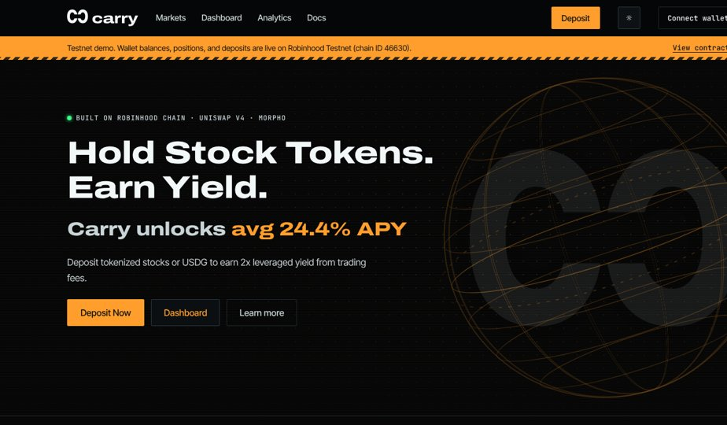

# Carry



Carry pays you trading fees on stock tokens that would otherwise sit idle in a wallet. Deposit any stock token on Robinhood Chain and Carry pairs it 1:1 with USDG, runs the position at 2×, and pays you a share of fees.

**Live site:** [usecarry.io](https://usecarry.io)

This repo is the **working Carry app + contracts**:

- **UI** — static site in `public/` (hash-routed marketing + app prototype)
- **Vault** — `contracts/` Forge project (`LeveredLpVault`) on **Robinhood Chain Testnet (46630)**
- **Product rules** — Maker-locked notes + live accounting in [`docs/MAKER_V1_NOTES.md`](./docs/MAKER_V1_NOTES.md), [`docs/MAKER_FEE_WATERFALL.md`](./docs/MAKER_FEE_WATERFALL.md) and [`docs/ACCOUNTING_V3.md`](./docs/ACCOUNTING_V3.md)
- **Keeper** — dry-run skeleton in [`keeper/`](./keeper/) (Hyperliquid read, no keys, no DualPool txs)

## Live product (testnet 46630)

| Deployed | Address |
| --- | --- |
| LeveredLpVault (**PROXY** / product CA) | [`0x24B799026AA7baa6856bCFD00c1Be1f583A83e35`](https://explorer.testnet.chain.robinhood.com/address/0x24B799026AA7baa6856bCFD00c1Be1f583A83e35) |
| Implementation (`version()` = **`v3-lender-pool`**) | [`0x7BeED7F65A9D4aF4E67553d984800F6268a3778E`](https://explorer.testnet.chain.robinhood.com/address/0x7BeED7F65A9D4aF4E67553d984800F6268a3778E) |
| Linked libraries (CarryMath / CarryPool / CarryCover) | `0x86b2…9344` / `0xf1d5…dc07` / `0x99f1…1ebd` |
| mockMSTR | `0x762019309B536bbb89577422FaaFBeC9659f8728` |
| mockUSDG | `0x25030Bff74764aD72b912276a603717DB1C00644` |
| v2.5 PROXY (**superseded**; settle-watch #5/#6/#7 remain) | `0xc80108649B3ba2e5B040c79DDE3af0cB979b72bd` |
| v1 grant/history reference (**not in use**) | `0x72A053120f03B10c5506d2325f92F59B0FfC36c8` |

Upgradeability: **UUPS**. v3 is a fresh PROXY (v2.5 was not upgraded in place). UI money paths use `public/config.json` → `chain.vault` (PROXY).

**`main` is ahead of the live implementation.** The proxy still runs the original v3 impl. Merged since and not yet upgraded on testnet: the EIP-170 fit (#3, runtime now ~23.4 KB), rolling positions with a 48h grace settle for underwater ones (#16), and the STRATEGY boost read from a separate `StrategyBoostHook` (#23). See [`docs/ACCOUNTING_V3.md`](./docs/ACCOUNTING_V3.md).

### Live accounting (v3)

- One lender pool (`totalSeniorAssets`) with non-transferable internal shares; senior yield compounds into the pool
- Lender withdraw instant when idle USDG allows, else FIFO queue + `claimWithdraw()`
- Fee split at `claimFees` / `earlyExit` / `settle`: Morpho-rate floor → 20% treasury (Boosted Level I-V via `boostHook`, placeholder 17.5/16.25/13.75/10/5%) → up to 20% senior perf → junior
- Floating `rateIndex` driven by an owner-set testnet stub (`morphoRateWad`, ≤5%). This is not a promised rate: the mainnet lender return is being reworked to Morpho yield + Carry's share of fees with no fixed rate (issue #20, PR #21)
- Min deposit / match **$25**; senior pool uncapped; junior market **$25k**; no per-wallet cap on any market
- Auto-compound; junior `gasCredit`; idle Morpho yield display-only on testnet

Details: [`docs/ACCOUNTING_V3.md`](./docs/ACCOUNTING_V3.md) · settle watch: [`docs/SETTLE_WATCH.md`](./docs/SETTLE_WATCH.md) · security: [`docs/SECURITY_V3.md`](./docs/SECURITY_V3.md).

Docs index: [`docs/README.md`](./docs/README.md).

## Run locally

```bash
npm install   # optional; scripts use npx serve
npm run dev
# open http://localhost:3000
```

Public chain settings live in `public/config.json` (`chain.live: true`). Example env vars (no secrets): `.env.example`.

### Live deposits (testnet)

When `chain.live` is true, MSTR / USDG **Deposit** (and USDG withdraw) call the vault via `window.ethereum`:

- Stock token (`MSTR`) → `depositJunior`
- `USDG` → `depositSenior`

Bridge: [`public/js/carry-vault.js`](public/js/carry-vault.js) / [`public/js/carry-chain.js`](public/js/carry-chain.js). Toggle demo-only mode with `"live": false` in `public/config.json`.

**Blockers before a real deposit succeeds:**

1. Vault must be **unpaused** (owner `0xcA44…3c57`). Live PROXY is currently unpaused.
2. Wallet needs testnet ETH from the [RH faucet](https://faucet.testnet.chain.robinhood.com).
3. Wallet needs mock tokens — `MockERC20.mint` is open; from the browser console after connect:  
   `CarryVault.mintDemo('MSTR', '10', /* chain cfg from config */) `  
   or mint via cast/explorer.

## Contracts

```bash
git submodule update --init --recursive
cd contracts && forge test
```

See [`CARRY_CONTRACT.md`](./CARRY_CONTRACT.md), [`CARRY_TESTNET.md`](./CARRY_TESTNET.md), and [`contracts/README.md`](./contracts/README.md).

**Never commit** private keys, `.deployer.key`, or `.env` files with secrets.

## Deploy on Vercel

1. Import this GitHub repo in Vercel.
2. Framework preset: **Other**. Build command: empty. Output directory: `public` (see `vercel.json`).
3. Deploy — or `npx vercel --prod`.

Production marketing/app: **usecarry.io**.

## Geoblock & simulate flags

`public/config.json` still drives geoblock and demo `simulate.*` states (loading, wrong network, etc.). See prior notes: `geoblock.simulateRegion`, `simulate.network`, `simulate.tx`. With `chain.live: true`, deposit/withdraw txs hit the vault instead of `simulate.tx`.

`analytics.simulate` (default `true`) fills the Analytics page with simulated protocol activity (users, volume, fees, deposits) that grows day by day and ticks up through the current day, with real vault activity added on top. Set it to `false` to show only static sample volume plus the real vault data.

`analytics.liveApy` (default `true`) switches the MSTR fee-pace figure from the sample number to one worked out from the vault's real fees: fees paid to positions minus the lender's Morpho-rate opportunity cost, over matched stock-time for the last 30 days (needs 1+ day of history, capped at 999%). That is a **realized fee-pace readout**, not a promised APY. The live value is always computed and available as `CarryChain.last.analytics.mstrApy` (`{ pct, days, fees }`) whether or not the flag is on. NVDA and the other markets stay simulated.

## Notes

- Pages use hash routing (`#home`, `#markets`, `#dashboard`, `#deposit`, …).
- Product position labels: **Idle / Active / Boosted / Closed** (not Open/Settled).
- `public/index.html` is a compiled bundle; live wiring is via `config.json` + `js/carry-vault.js` / `carry-chain.js`.
- DualPool / Morpho sleeve / live STRATEGY token wiring are **not** on testnet 46630 (Morpho rate and Idle USDG APY are config stubs; on `main`, Boosted reads a `StrategyBoostHook`, none set on testnet yet).
- Disclaimers are placeholders pending legal review.
